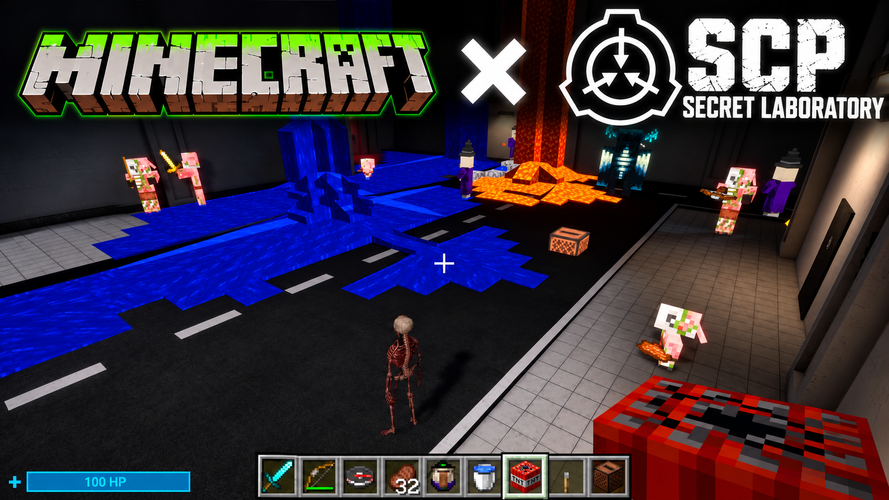
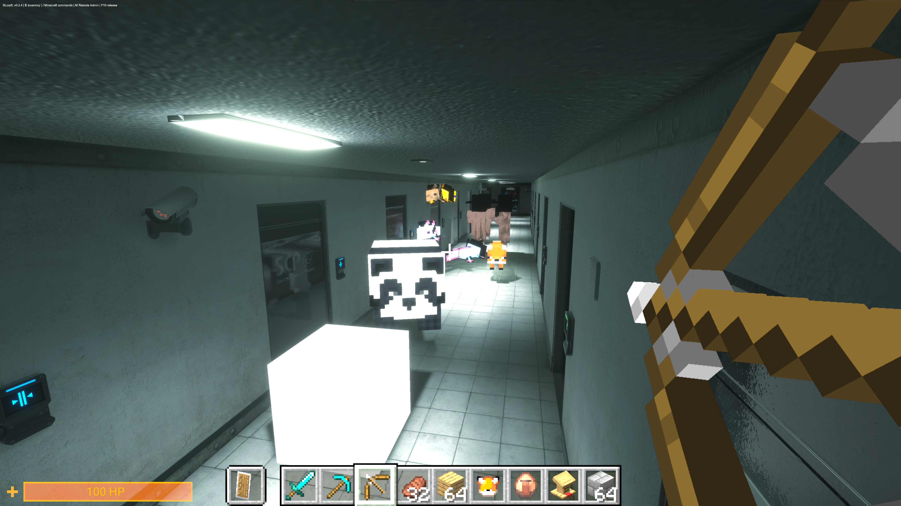

# SLCraft Client 0.2.6



[English](README.md)

> **클라이언트 전용 — 이 빌드를 서버에 절대 설치하거나 실행하지 마세요.**
> SLCraft 0.2.6은 Windows 게임 클라이언트에서만 사용하는 빌드입니다. SCP:SL 전용·헤드리스 서버, Minecraft 전용 서버, 공개·원격 서버에 배포하면 안 됩니다. LabAPI나 EXILED 서버 플러그인이 아니며, 서버 배포용 패키지는 제공하지 않습니다.

오프라인 로컬 호스트와 Minecraft의 내부 월드 시뮬레이션은 로컬 클라이언트 세션 안에서 실행됩니다. 이것이 전용 서버용 모드라는 뜻이거나 서버 배포를 허용한다는 뜻은 아닙니다.

SCP:SL 시설 안에서 Minecraft의 손·HUD·인벤토리·블록·엔티티·이동을 사용하는 Windows x64 실험용 클라이언트입니다. 별도 오프라인 1인 로컬 호스트를 지원합니다.

## 다른 사람에게 배포하기

- ZIP: `releases/SLCraft-Client-0.2.6.zip`과 `.sha256` 파일을 GitHub Releases에 올립니다.
- 소스 저장소: 이 폴더에서 일반적인 Git 추가·커밋을 수행하면 `.gitignore`가 게임·백업·캐시·월드·개인 로그를 제외합니다. `git add -f`로 제외 규칙을 무시하지 마세요.
- 실제 공유 대상은 `distribution/`, `scripts/`, 이 README와 루트 실행 래퍼입니다. GitHub 업로드·커밋·push는 아직 하지 않았습니다.
- 초기 `outputs/SLcraft-0.1.0.zip`은 구형 서버 연동 시제품이며 현재 클라이언트 통합판 배포 파일이 아닙니다.

## 설치와 실행

지원되는 SCP:SL 14.2.7 원본, .NET SDK 10 이상, JDK 25 이상을 준비한 뒤 `Setup.cmd`를 실행하세요. 준비가 끝나면 `Start-Client.cmd`로 실행합니다. 자세한 절차·요구 공간·한계는 [설치 안내](distribution/README.ko.md)에 있습니다.

배포 ZIP에는 게임 원본이나 개발자의 저장 월드가 없습니다. 설치 도구가 사용자 PC의 SCP:SL을 별도 폴더에 복사하고 필요한 의존성을 내려받습니다. 압축 파일은 작아도 실제 설치 공간은 별도로 필요합니다. Minecraft는 현재 Gradle 개발 실행 방식을 사용합니다.

## 배포 파일 다시 만들기

PowerShell 7에서 실행합니다.

```powershell
.\scripts\Build-Distribution.ps1
.\scripts\Test-Distribution.ps1
```

`distribution/payload`에는 현재 0.2.6 DLL/JAR만 들어 있습니다. 소스 수정 후 빌드와 payload 체크섬 갱신은 개발자가 별도로 수행해야 합니다. 포장 스크립트는 현재 payload와 소스를 묶으며 임의로 게임을 실행하거나 설치하지 않습니다.

## 로컬 개발 자료

기존 `outputs/SLcraftClient`, `work`, `migration-original`은 개발·복구에 사용하는 로컬 자료이며 Git에서는 제외합니다. 새 배포본을 설치하기 전에는 루트 실행 래퍼가 기존 개발 실행본이 있으면 사용하며, GitHub에서 새로 받은 사용자는 공개 설치 절차를 따릅니다.

[라이선스와 외부 구성 요소](distribution/THIRD-PARTY-NOTICES.ko.md), [배포판 검증 기록](distribution/VALIDATION.ko.md). 모든 문·경사·역할을 검증한 상태는 아닙니다.


